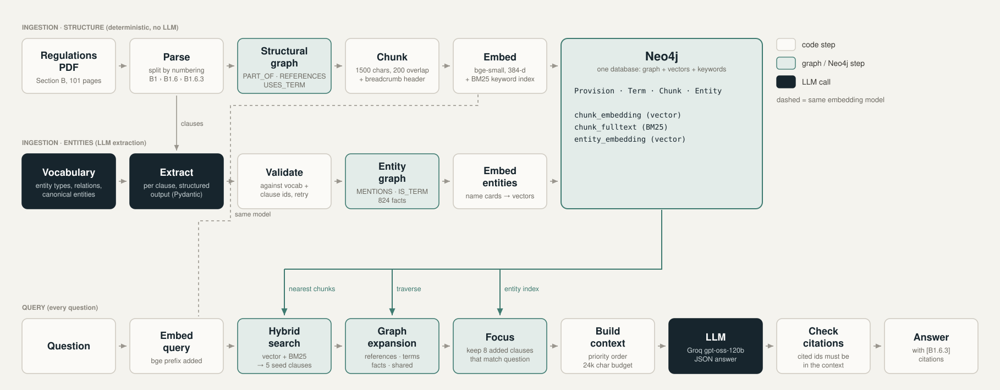
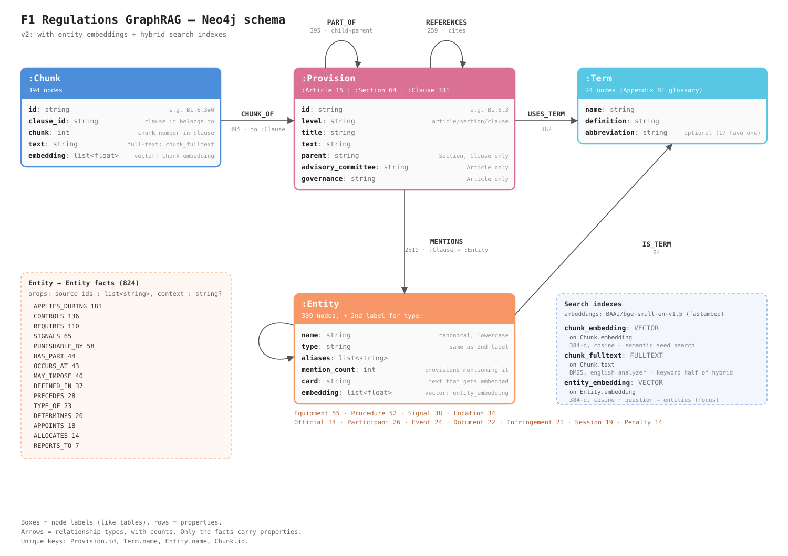

# F1 Regulations GraphRAG

A smart search over the FIA 2026 F1 Sporting Regulations (Section B, Issue 09) built with GraphRAG. For a question, it gives an AI-generated answer, the clauses that answer cites, and other clauses found through vector search and the graph. It was built mainly to learn GraphRAG.

## Inputs and outputs

- **Regulations:** The source is the regulations PDF (`docs/raw-document/FIA 2026 F1 Regulations Section B.pdf`), parsed into 410 provisions (15 articles, 64 sections, 331 clauses) and 24 glossary terms (`data/parsed/`).
- **Input:** A question in natural language, typed on the web page or passed to `f1rag ask`.
- **Output:** Structured JSON (see the `Answer` schema in `src/f1rag/search/llm.py`): `answer` (Markdown with inline citations such as `[B1.6.3]`), `citations` (clause IDs) and `answerable`. The web API also returns the full text of each cited clause, plus the other retrieved and graph-added clauses.

## How it works



**Ingestion**
- **Chunking:** The PDF is split along its own numbering (article → section → clause, e.g. `B1.6.3`), not into fixed-size chunks. Long clauses are split again into 394 chunks of up to 1500 characters, each with a breadcrumb header.
- **Structural graph (no LLM):** Neo4j holds the hierarchy (`PART_OF`), cross-references taken from mentions like "Article B1.9.3" (`REFERENCES`) and links to the glossary (`USES_TERM`).
- **Entity graph:** Claude extracted entities against a fixed vocabulary (`data/entities/vocab.json`: 11 entity types, 15 relation types, 339 entities). It produced 2519 clause mentions and 824 relationships, each traced to the clauses that state it. `scripts/extraction/` regenerates the JSON in `data/entities/extractions/`.
- **Embeddings:** The local `BAAI/bge-small-en-v1.5` model (fastembed) embeds the clause chunks and the entity name cards into two Neo4j vector indexes. A full-text (BM25) index is built over the chunks.

**Retrieval and answering**
- **Seeds:** Hybrid search (vector + keyword) finds the top clauses.
- **Graph expansion:** Each seed adds the clauses it references, glossary definitions, clauses that share rare entities, and entity facts. Hub entities (mentioned in more than 12 clauses) are skipped.
- **Focus:** The question is matched to its 10 closest entities. Only the 8 graph-added clauses that mention the most of them are kept.
- **LLM:** The open model `openai/gpt-oss-120b` on the Groq API, with structured JSON output and temperature 0. It answers only from the context, and any cited ID that isn't in the context is flagged.
- **Evaluation:** A golden set of 25 questions (`data/eval/golden_set.json`) compares retrieval across modes: vector only, structural graph, full graph, focused graph and hybrid.

**Neo4j schema**



Stack: Python, LangChain (`langchain-neo4j`, `langchain-groq`), Neo4j AuraDB Free, FastAPI, and a plain HTML/JS page in `web/`.

## Run it

Python 3.10+, a Neo4j database (AuraDB Free works) and a Groq API key.

```bash
python3.12 -m venv .venv && source .venv/bin/activate
pip install -e .
cp .env.example .env                                  # set GROQ_API_KEY and the NEO4J_* values

# Build the graph (data/parsed and data/entities are already in the repo)
python -m f1rag.ingest.graph structure --reset        # provisions, hierarchy, references, glossary
python -m f1rag.ingest.graph entities                 # entities and relationships
python -m f1rag.ingest.embed chunks                   # clause chunks + vector and full-text indexes
python -m f1rag.ingest.embed entities                 # entity name cards + vector index

# Search
f1rag ask "Can a driver use Overtake while the safety car is out?"
f1rag serve                                           # web page at http://localhost:8000
python -m f1rag.evaluation.evaluate                   # retrieval metrics on the golden set
```

To re-parse the PDF: `python -c "from f1rag.ingest import parse; parse.run()"`.
